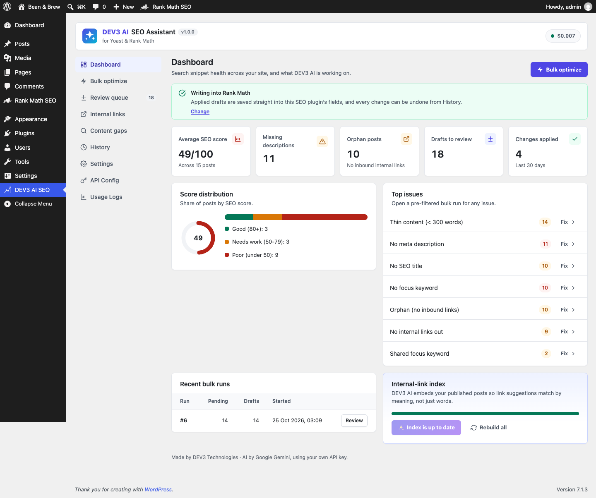

# DEV3 AI SEO Assistant for Yoast & Rank Math

AI meta titles, descriptions, focus keywords, schema, internal links, content gaps and FAQ blocks, written into Yoast SEO and Rank Math fields as reviewable drafts.



## Features

DEV3 AI SEO Assistant is an add-on for **Yoast SEO** and **Rank Math** (free or premium). SEOPress and All in One SEO are supported too, and without an SEO plugin DEV3 prints the tags itself.

Every suggestion is a **draft with a diff**. You apply it field by field, every applied change is kept in **History with undo**, and bulk runs work in the background.

**In the block editor (DEV3 AI SEO sidebar)**

* Google-style snippet preview (desktop and mobile) with character and pixel meters.
* SEO title, meta description, focus keyword (Rank Math: several keywords), social title and description. Up to 3 options per field.
* Schema suggestions: Yoast page/article type, Rank Math main type override, plus extra JSON-LD pieces (HowTo, FAQPage, Product, Event…) merged into the SEO plugin's schema graph.
* Internal-link suggestions using embeddings across your posts, with the anchor text highlighted in its paragraph. One click inserts the link.
* Content gaps and outline: coverage score, missing subtopics, questions, terms, and an outline you can insert as headings.
* FAQ blocks: inserted as the Yoast FAQ block or the Rank Math FAQ block (they print FAQPage schema), or core Details blocks with DEV3 schema.
* SEO checks and a 0-100 score, and the post's change history with undo.

**In wp-admin**

* Dashboard: site score, top issues, recent runs, link index.
* Bulk optimize: filter posts (type, status, issue such as "no meta description"), select, and draft fields for up to 2,000 posts in a background job.
* Review queue: diff, edit, apply or reject per field, in bulk, or a whole run at once. Conflict check when a value changed since the draft was made.
* Internal links report (inbound/outbound, orphans) and the embeddings index.
* Content gaps report: duplicate titles, keyword cannibalisation, thin content, orphans, missing alt text, and AI topic ideas.
* History: every applied value with before/after, undo per change or per run.
* Posts list: "SEO (DEV3)" score column and an "Optimize with DEV3 AI" action.

**Works without AI.** With AI off or no API key you still get checks, scores, reports, basic suggestions (rules-based titles, descriptions, keywords, schema type, FAQ from question headings), word-match link suggestions and history.

*Set a monthly budget in API Config.

## Requirements

- WordPress 6.0 or newer (tested up to 6.8)
- PHP 7.4 or newer
- Optional: your own Google AI API key (from Google AI Studio) to switch on the DEV3 AI features. The rest of the plugin works without one.

## Installation

### From the release zip

1. Download `dev3-ai-seo-assistant.zip` from the [latest release](https://github.com/dev3tech/dev3-ai-seo-assistant/releases/latest).
2. In WordPress, go to **Plugins → Add New → Upload Plugin**, choose the zip and click **Install Now**.
3. Click **Activate**.

### Build from source

```bash
git clone https://github.com/dev3tech/dev3-ai-seo-assistant.git
cd dev3-ai-seo-assistant
composer install --no-dev
npm ci
npm run build
```

Then copy the `dev3-ai-seo-assistant` folder into `wp-content/plugins/` and activate it.

### Getting started

1. Upload the plugin zip in Plugins > Add New > Upload and activate it.
2. Install Yoast SEO or Rank Math if you have not already. With Rank Math, finish or skip its setup wizard so it prints its head tags.
3. Go to DEV3 AI SEO > API Config and paste a Google AI API key (https://aistudio.google.com/apikey).
4. Open any post in the block editor and click the DEV3 AI SEO icon in the top bar.

## FAQ

### Does it change my posts without asking?
No. Everything is a draft until you click Apply, and every applied change can be undone from History.

### What if I edit the Yoast or Rank Math field myself?
Applying a draft checks the live value first and asks before overwriting. Undo does the same.

### Does it work with the classic editor?
The sidebar needs the block editor. Classic-editor sites use the post screen in DEV3 AI SEO (Bulk optimize > Open), which has every tool.

### What data is sent to Google?
Only the post title, slug, excerpt, headings and up to 6,000 characters of text, for the feature you run. PII masking can be turned on in API Config.

## Documentation

The full HTML guide (installation, settings, hooks and FAQ) is in [`docs/index.html`](docs/index.html). Open it in a browser after cloning or downloading the repository.

## Changelog

### 1.0.0
* Initial release.

## Licence

Released under the GNU General Public License v2.0 or later (GPL-2.0-or-later). See [LICENSE](LICENSE).

## More from DEV3

- [DEV3 AI SEO Assistant for Yoast & Rank Math on the DEV3 Marketplace](https://www.dev3.tech/item/dev3-ai-seo-assistant)
- [More WordPress plugins, themes and templates from DEV3](https://www.dev3.tech/marketplace)
